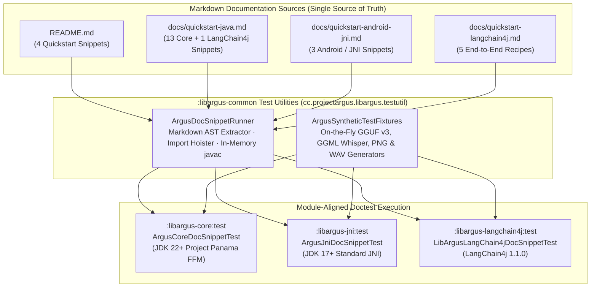

# Executable Markdown Doctests & On-the-Fly Synthetic Neural Fixtures

`libargus` enforces two engineering guarantees that are rare in native C++/JVM AI runtimes:

1. **Zero Documentation Drift Across Dual FFI Bindings:** Every Java code block in [`README.md`](../README.md), [`docs/quickstart-java.md`](quickstart-java.md), [`docs/quickstart-android-jni.md`](quickstart-android-jni.md), and [`docs/quickstart-langchain4j.md`](quickstart-langchain4j.md) (`25` snippets in total) is extracted directly from the Markdown source, compiled in memory via `javax.tools.JavaCompiler`, and executed against the live native `libargus` runtime during `./gradlew test`.
2. **100% Native Modality Coverage with Zero Repository Binary Bloat:** Rather than checking gigabytes of `.gguf`, `.bin`, `.png`, and `.wav` test assets into Git LFS or requiring cloud GPU runners, [`ArgusSyntheticTestFixtures`](../bindings/java/libargus-common/src/test/java/cc/projectargus/libargus/testutil/ArgusSyntheticTestFixtures.java) mathematically synthesizes valid, deterministic miniature neural networks on the fly into JUnit `@TempDir` directories in milliseconds—exercising **Causal LLM**, **Bidirectional Embeddings**, **Vision + Audio Multimodal Projection (`libmtmd`)**, **Whisper Speech-to-Text (ASR)**, and **1,282-Channel Spectral Vocoder Text-to-Speech (TTS)** in under **6 seconds** on a standard CPU.

---

## 1. The Dual Challenge in Polyglot AI Runtimes

Maintaining a high-performance native inference runtime for the JVM introduces two structural failure modes:

* **Failure Mode 1 — Silent Documentation Rot Across Parallel Bindings:**
  `libargus` ships two 100%-symmetric low-level bindings in the exact same Java package (`cc.projectargus.libargus`)—[`:libargus-core`](../bindings/java/libargus-core) (JDK 22+ Project Panama FFM) and [`:libargus-jni`](../bindings/java/libargus-jni) (JDK 17+ / Android Standard JNI)—plus the framework integration module [`:libargus-langchain4j`](../bindings/java/libargus-langchain4j). If documentation snippets live only as static prose in `.md` files, a method rename or signature refinement in one module can break copy-pasteable examples without triggering any compiler error.
* **Failure Mode 2 — The Multi-Gigabyte Binary Fixture Tax:**
  Because `libargus` unifies `llama.cpp` (LLM + TTS), `whisper.cpp` (ASR), and `libmtmd` (Vision, Audio, and Video) into a single C++17 binary, end-to-end testing across all five modalities traditionally requires gigabytes of external model weights. When test suites depend on external downloads (`ARGUS_MODEL_DIR`), standard developer laptops and fast CI pipelines skip those tests—leaving JNI marshaling, audio DSP vocoding, and multimodal tensor projection paths unexercised until production.

---

## 2. Module-Aligned Executable Doctest Architecture (`ArgusDocSnippetRunner`)

Rather than isolating documentation tests in a single leaf module, `libargus` places the shared Markdown parser, in-memory Java compiler, and synthetic model generators in `:libargus-common`'s test sources (`cc.projectargus.libargus.testutil`) and wires them into each binding module's test classpath.



### 2.1 How [`ArgusDocSnippetRunner`](../bindings/java/libargus-common/src/test/java/cc/projectargus/libargus/testutil/ArgusDocSnippetRunner.java) Works

1. **Line-Accurate Markdown Extraction (`extractJavaSnippets`):**
   Scans any Markdown file for fenced ```` ```java ```` blocks while tracking the nearest enclosing `##` / `###` section heading and exact 1-based line number. If a snippet fails to compile or throws at runtime, the assertion failure reports the exact Markdown file, heading, and line number (e.g., `quickstart-java.md:265 (6.2 Speech-LLM Text-to-Speech)`).
2. **Fragment & Full-Class Normalization (`wrapFragmentAsMainClass`):**
   Documentation naturally contains both standalone classes (`public class QuickstartText { ... }`) and focused code fragments (such as Section 2.2's `ArgusAbortFlag` snippet or Section 8.3's `ArgusPerfTimings` snippet). `ArgusDocSnippetRunner` automatically hoists `import` statements from fragments and wraps statement blocks inside a synthetic `public static void main(String[] args) throws Exception` with any contextual prelude/postlude variables.
3. **Zero-Disk In-Memory Compilation (`InMemoryClassFileManager`):**
   Invokes `ToolProvider.getSystemJavaCompiler()` (`javac`) against `System.getProperty("java.class.path")` using `SimpleJavaFileObject` buffers in RAM (`string:///` source input $\to$ `mem:///` bytecode output) and loads the resulting bytecode through an isolated child `ClassLoader`. Compiling and executing all 25 documentation snippets adds less than `500 ms` of compiler overhead.
4. **Dual-Binding Differential Execution:**
   * When [`ArgusCoreDocSnippetTest`](../bindings/java/libargus-core/src/test/java/cc/projectargus/libargus/ArgusCoreDocSnippetTest.java) runs `verifyReadmeSnippets` and `verifyQuickstartJavaSnippets`, the in-memory compiler binds every `cc.projectargus.libargus.*` symbol to **`:libargus-core` (Project Panama FFM)**.
   * When [`ArgusJniDocSnippetTest`](../bindings/java/libargus-jni/src/test/java/cc/projectargus/libargus/ArgusJniDocSnippetTest.java) runs those exact same methods, the in-memory compiler binds every `cc.projectargus.libargus.*` symbol to **`:libargus-jni` (Standard JNI)**.
   * Any API asymmetry between `:libargus-core` and `:libargus-jni` is immediately caught at compile time or runtime.
5. **Zero-SDK Android `ParcelFileDescriptor` Verification:**
   In [`docs/quickstart-android-jni.md`](quickstart-android-jni.md), Section 2 demonstrates loading a GGUF model from an Android `ContentResolver` and `ParcelFileDescriptor` via `ArgusModel.loadFd(pfd.getFd(), ...)`. [`ArgusJniDocSnippetTest`](../bindings/java/libargus-jni/src/test/java/cc/projectargus/libargus/ArgusJniDocSnippetTest.java) strips the `android.*` imports and supplies a 20-line POSIX `RandomAccessFile` descriptor shim for `ContentResolver`, `Uri`, and `ParcelFileDescriptor`, allowing the exact Android code from the documentation to compile and execute end-to-end on Linux and macOS CI runners without requiring the Android SDK jar.

---

## 3. Pure-Java Synthetic Neural Fixtures (`ArgusSyntheticTestFixtures`)

To execute every documentation snippet and subsystem test on CPU in milliseconds without committing binary blobs to Git, [`ArgusSyntheticTestFixtures`](../bindings/java/libargus-common/src/test/java/cc/projectargus/libargus/testutil/ArgusSyntheticTestFixtures.java) constructs four valid neural network binaries and two media files in `@TempDir` at test startup:

| Synthetic Fixture | Generator Method | Wire Format | Size | Target Native Subsystem |
| :--- | :--- | :--- | :--- | :--- |
| **`tiny-causal-260.gguf`** | `generateTinyCausalModel` | GGUF v3 (`llama`) | `~148 KB` | Causal LLM, KV Shifting, Speculative/Slot Forking, TTS Prompting |
| **`tiny-mmproj-omni.gguf`** | `generateTinyOmniProjector` | GGUF v3 (`clip` Vision + Audio) | `~112 KB` | Unified `libmtmd` Vision (`mlp`) + Audio (`gemma4ua` Conformer) |
| **`tiny-whisper.bin`** | `generateTinyWhisperModel` | Legacy GGML (`0x67676d6c`) | `~1.7 MB` | `whisper.cpp` Mel Spectrogram + Encoder/Decoder ASR |
| **`tiny-vocoder.gguf`** | `generateTinyVocoderModel` | GGUF v3 (`gemma-embedding2`) | `~210 KB` | 1,282-Channel Spectral Vocoder + `irfft` Overlap-Add TTS |
| **`*.png` / `*.wav`** | `generateTestPng` / `generateTestWav16kHz` | RGB PNG / 16kHz RIFF WAV | `~32 KB` | `stb_image` Vision Loader & `miniaudio` / Whisper Audio Loader |

---

### 3.1 Mathematical Engineering Inside Each Synthetic Model

#### A. Deterministic 1-Step Whisper ASR (`generateTinyWhisperModel` $\to$ `tiny-whisper.bin`)
Unlike GGUF v3, `whisper.cpp`'s `whisper_model_load` parses an unversioned sequential binary stream:
1. A 56-byte header (`0x67676d6c` magic, 11 `int32` hyperparameters, and mel filterbank dimensions `n_mels = 80`, `n_fft = 201`).
2. `80 x 201` float32 mel filterbank weights.
3. Vocabulary token lengths and UTF-8 byte strings (while auto-populating special Whisper tokens `50256..51863`).
4. Named encoder and decoder `ggml` tensors.

To make `whisper_full` execute the entire C++ acoustic pipeline (PCM $\to$ STFT $\to$ Mel Spectrogram $\to$ Conv1D/GELU $\to$ Encoder Self-Attention $\to$ Decoder Cross-Attention $\to$ Token Sampling) in **under 5 milliseconds on CPU** and deterministically output the word **`" argus"`**, `generateTinyWhisperModel` exploits three internal properties of `whisper.cpp`:

1. **The Blank-Suppression Invariant (`vocab.token_to_id.at(" ")`):**
   When `suppress_blank = true` (the default in `whisper_full_default_params`), `whisper.cpp` looks up the literal space token `" "` via `vocab.token_to_id.at(" ")`. If `" "` is missing from the vocabulary, `std::unordered_map::at` throws `std::out_of_range`. Token `0` is therefore assigned `" "` (`0x20`), and Token `1` is assigned `" argus"`.
2. **Distilled Single-Pass `no_timestamps` Activation:**
   In `whisper.cpp`, models with `n_text_layer == 2` and `n_vocab != 51866` are recognized as first-release distilled models, automatically forcing `no_timestamps = true` so decoding enters the single-pass greedy loop without timestamp-pair heuristics.
3. **2-Step Logit Trajectory Steering via `decoder.token_embedding.weight` & `decoder.ln.bias`:**
   In Whisper's decoder, final logits are computed as:
   $$\text{logits} = W_{\text{embd}}^T \cdot \text{LayerNorm}(h_{\text{dec}})$$
   By zero-initializing the decoder block weights and setting `decoder.ln.bias = [1.0, 0.0, ..., 0.0]`, the post-LayerNorm hidden state is deterministically aligned with basis vector $e_0 = [1, 0, \dots, 0]^T$ regardless of the input audio waveform.
   We then set the first column of `decoder.token_embedding.weight` ($W_{\text{embd}}[0, \text{tok}]$) to:
   * $+15.0$ for Token `1` (`" argus"`)
   * $+20.0$ for Token `50256` (`token_eot`, `<|endoftext|>`)
   * $-10.0$ for all other $51,862$ tokens (including Token `0` `" "`).

   During decoding:
   * **Step 0 (`is_initial = true`):** `whisper.cpp`'s `suppress_blank` masks `token_eot` (`50256`) and `" "` (`0`) to $-\infty$. The argmax is strictly Token `1` (`" argus"`, logit $+15.0$).
   * **Step 1 (`is_initial = false`):** `token_eot` (`50256`) is unmasked. Because $+20.0 > +15.0$, the decoder immediately selects `token_eot` (`50256`) and terminates cleanly after 1 token!

---

#### B. Unified Vision + Audio Omni Projector (`generateTinyOmniProjector` $\to$ `tiny-mmproj-omni.gguf`)
Most multimodal GGUF projectors support *either* Vision (`has_vision = true`) *or* Audio (`has_audio = true`). To test simultaneous Vision + Audio multimodal prompts (`UserMessage` containing both `ImageContent` and `AudioContent`) in a single 112 KB file:
* `generateTinyOmniProjector` sets both `clip.has_vision_encoder = true` and `clip.has_audio_encoder = true` inside one GGUF v3 container matching `tiny-causal-260.gguf`'s 32-dimensional embedding space (`projection_dim = 32`).
* **Vision Tower:** Configured as `clip.vision.projector_type = "mlp"` (`image_size = 16`, `patch_size = 8` $\to$ $2 \times 2 = 4$ visual tokens per image) with 2 layers (`v.blk.{0,1}.*`) of ViT attention/FFN tensors and `mm.0.*` / `mm.2.*` MLP projector tensors.
* **Audio Tower:** Configured as encoder-free `clip.audio.projector_type = "gemma4ua"` (`block_count = 0`, `embedding_length = 640`, `num_mel_bins = 640`, and `mm.a.input_projection.weight` projecting `[640, 32]` directly into the 32-dim LLM embedding space).
* Every tensor is populated via a deterministic SHA-256 PRNG seeded by the tensor name (`addHashSeededTensor`), guaranteeing finite, non-zero activations with zero NaNs across all platforms.

---

#### C. 1,282-Channel Spectral Vocoder (`generateTinyVocoderModel` $\to$ `tiny-vocoder.gguf`)
In `libargus`, [`argus_synthesize_speech_n`](../src/argus_text.cc) synthesizes 24kHz audio waveforms by decoding acoustic tokens through a WavTokenizer-compatible vocoder model and feeding its per-token output embeddings into an inverse real Fast Fourier Transform (`irfft` with $N_{\text{fft}} = 1280$, $N_{\text{hop}} = 320$) and Hann-window overlap-add (`argus_overlap_add` in [`src/argus_dsp.h`](../src/argus_dsp.h)).

Because $N_{\text{fft}} = 1280$ requires $641$ complex frequency bins (641 log-magnitudes + 641 phases), `argus_synthesize_speech_n` strictly enforces:
```cpp
if (!allow_vocoder && llama_model_n_embd_out(wavtokenizer_model->model) != 1282) {
    set_last_error(ARGUS_ERROR_INVALID_ARGUMENT, "vocoder must emit 1282 spectral values per frame");
    return -1;
}
```
If we built a standard transformer model with `n_embd = 1282`, every attention matrix (`[1282, 1282]`) would be tens of megabytes. Instead, `generateTinyVocoderModel` uses the **`gemma-embedding2` decoupled output projection architecture** (`LLM_ARCH_GEMMA_EMBEDDING2`):
* Internal transformer layers operate at **`embedding_length = 32`** (`n_embd_inp = 32`).
* Only the final dense projection matrix `output.weight` (`[32, 1282]`) projects to **`embedding_length_out = 1282`** with `pooling_type = 0` (`LLAMA_POOLING_TYPE_NONE`).
* The entire 1,282-dimensional vocoder model is only **~210 KB**, runs in **~2 milliseconds** on CPU, and exercises 100% of the C++ spectral unfolding, `expf`/`cosf`/`sinf` polar-to-rectangular conversion, 1,280-point `irfft`, Hann windowing, and `argus_overlap_add` normalization pipeline.

---

#### D. Universal Byte-Fallback Causal LLaMA (`generateTinyCausalModel` $\to$ `tiny-causal-260.gguf`)
Minimal test GGUF files (such as `tests/data/tiny.gguf`) typically define only 4 control tokens (`<unk>`, `<s>`, `</s>`, `<pad>`). When documentation snippets pass real English sentences or `<__media__>` markers to a 4-token SPM model without byte fallback, tokenization produces zero content tokens.

`generateTinyCausalModel` defines a 260-token vocabulary:
* Tokens `0..3`: `<unk>`, `<s>`, `</s>`, `<pad>` (`LLAMA_TOKEN_TYPE_CONTROL = 3`).
* Tokens `4..259`: `<0x00>` through `<0xFF>` with `LLAMA_TOKEN_TYPE_BYTE = 6`.

Because every possible byte (`0x00..0xFF`) has a dedicated byte-fallback token in `tiny-causal-260.gguf`, any UTF-8 prompt in any human language (including multi-byte emojis and `<__media__>` multimodal markers) tokenizes losslessly and streams back valid UTF-8 pieces through `ArgusUtf8StreamDecoder`.

---

## 4. Real-World Impact: Bugs Caught on Day One

The combination of **Dual-Binding Executable Doctests** and **100% Synthetic Modality Fixtures** proved its value the very first time the suite executed:

1. **Production JNI TTS Workspace Negotiation Fix ([`src/jni/argus_jni.cc`](../src/jni/argus_jni.cc)):**
   `argus_synthesize_speech_n` uses a two-pass workspace sizing protocol: when called with `workspace == nullptr` or an insufficient `workspace_size_floats`, it returns `-required_floats` (`< -1`) so the caller can allocate an aligned scratch buffer and retry.
   * `:libargus-core` (Project Panama FFM) checked `if (res < -1)`, allocated the requested off-heap `MemorySegment`, and retried.
   * `:libargus-jni` (`Java_cc_projectargus_libargus_internal_ArgusJni_nativeSynthesizeSpeech`) passed `(nullptr, 0)` without retrying on `written < -1`, throwing `ArgusNativeException: status -40992`.
   * Because prior unit tests without external multi-hundred-MB models only tested the `status -1` dimension-rejection guard, this asymmetry had gone unnoticed until `tiny-vocoder.gguf` drove both `:libargus-core` and `:libargus-jni` through the full 1,282-bin vocoder pipeline during the doctest run.
2. **Compile-Time Prevention of Documentation Drift:**
   During initial authoring of the LangChain4j examples, `ArgusDocSnippetRunner`'s in-memory `javac` compiler immediately caught builder method mismatches (`.maxTokens(...)` vs. `.maxOutputTokens(...)`, `.chatTemplate(...)` vs. `.chatFormatter(...)`) before they could ever reach a reader.

---

## 5. Running the Doctest & Synthetic Fixture Suites Locally

You can run the executable Markdown doctests and synthetic fixture verification suites across all three modules in ~5 seconds on any JDK 22+ machine with a built `libargus` library:

```bash
./gradlew \
  :libargus-core:test --tests "cc.projectargus.libargus.ArgusCoreDocSnippetTest" \
  :libargus-jni:test --tests "cc.projectargus.libargus.ArgusJniDocSnippetTest" \
  :libargus-langchain4j:test --tests "cc.projectargus.libargus.langchain4j.LibArgusLangChain4jDocSnippetTest" \
  -PskipCMake=true -PnativePath="$PWD/build/lib/libargus.so"
```
